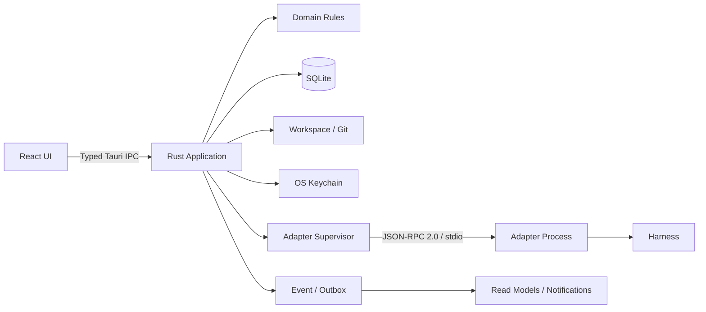

# 技术栈、技术规范与工程标准

> 版本：1.0（冻结）  
> 变更方式：仅限经 Human 确认的 ADR  
> 目标：以最小而可靠的本地架构通过 PRD AC-01～AC-12

## 1. 架构总则

平台采用 **local-first 模块化单体 + 外部 Adapter 子进程**。UI 不持有业务事实，Adapter 不直写数据库，所有状态变化必须经过 Rust 应用层的状态、权限、幂等和审计检查。



强制边界：

- React 只负责展示、输入和短生命周期 UI 状态，不复制领域状态机。
- Application 层编排事务、权限、幂等和 Event；Domain 层不依赖 Tauri、SQLite、Git 或具体 Harness。
- Persistence、Workspace、Security、Adapter 均通过端口/trait 接入。
- Adapter 是不完全可信输入源；所有回调重新鉴权、校验版本和 fencing token。
- 不创建微服务、不开放本地 HTTP 端口、不引入消息中间件，除非新 ADR 证明必要。

## 2. 冻结技术栈

精确 patch 版本在脚手架节点通过 manifest 与 lockfile 固定；未经 ADR 不跨 major。

| 层 | 选型 | 版本基线 | 用途与约束 |
|---|---|---:|---|
| 桌面壳 | Tauri | 2.x | 窗口、IPC、能力白名单、签名与应用生命周期。 |
| 控制面 | Rust | stable，`rust-toolchain.toml` 固定 | 领域、SQLite、Git、进程、权限、安全与审计。 |
| 异步运行时 | Tokio | 1.x | 子进程、心跳、取消和后台任务；禁止阻塞异步执行器。 |
| 持久化 | SQLite + SQLx | SQLite 3.x / SQLx 0.8.x | 单机事务、迁移、查询；`foreign_keys=ON`、WAL。 |
| 序列化/Schema | Serde + Schemars | 同一 lockfile | IPC/Adapter DTO 与 JSON Schema 单一来源。 |
| 日志与追踪 | tracing | 0.1.x | 结构化日志、request/run/task 关联、脱敏。 |
| 前端 | React + TypeScript | React 19.x / TS 5.9+ | strict 模式；禁止 `any` 逃逸业务契约。 |
| 构建 | Vite + pnpm | Vite 7.x / pnpm 10.x / Node 24 LTS | 前端构建与依赖锁定。 |
| 路由 | TanStack Router | 1.x | 类型化导航；页面状态可恢复。 |
| 服务端状态 | TanStack Query | 5.x | IPC 查询缓存与失效；不得作为事实源。 |
| UI 状态 | Zustand | 5.x | 只用于抽屉、筛选草稿等瞬时状态。 |
| 表单 | React Hook Form + Zod | 当前锁定稳定版 | 客户端即时校验；服务端仍必须重复校验。 |
| UI 基础 | Radix Primitives + Tailwind CSS | Radix 1.x / Tailwind 4.x | 可访问交互原语 + Figma Token；不直接套通用后台主题。 |
| 图标 | Lucide React | 当前锁定稳定版 | 统一线性图标；状态不能只靠图标/颜色。 |
| 单元/组件测试 | Vitest + Testing Library + axe-core | 当前锁定稳定版 | UI 行为与无障碍。 |
| E2E | Playwright + Tauri WebDriver/平台驱动 | 当前锁定稳定版 | Web 交互与真实桌面边界分层验证。 |
| Rust 测试 | cargo test/nextest + proptest | 当前锁定稳定版 | 单元、集成、状态机性质测试。 |
| 依赖安全 | cargo-deny/cargo-audit + pnpm audit | CI 固定版 | 许可证、漏洞和重复依赖门禁。 |

禁止替换为另一套前端框架、数据库、ORM、桌面壳或状态库，除非 ADR 明确给出迁移与回退方案。

## 3. 建议仓库结构

```text
/
├── apps/
│   └── desktop/
│       ├── src/                    # React UI
│       └── src-tauri/              # Tauri 入口，仅做装配
├── crates/
│   ├── domain/                     # 实体、值对象、状态机、不变量
│   ├── application/                # 命令、查询、事务、权限与幂等编排
│   ├── contracts/                  # IPC/Adapter DTO 与 Schema
│   ├── persistence-sqlite/         # SQLx repository、migration、backup
│   ├── workspace/                  # 路径、Git/worktree、引用、Artifact
│   ├── adapter-supervisor/         # 子进程、JSON-RPC、心跳、对账
│   ├── security/                   # 权限、凭据引用、脱敏
│   └── observability/              # tracing、metrics、audit verification
├── adapters/
│   ├── mock/
│   └── codex/
├── packages/
│   ├── contracts-ts/               # 由 Schema 生成；禁止手改
│   ├── design-tokens/
│   └── test-fixtures/
├── migrations/
├── tests/
│   ├── contract/
│   ├── integration/
│   └── e2e/
├── docs/
│   ├── adr/
│   └── development/
└── scripts/                        # 可复现检查；不得藏业务逻辑
```

依赖方向固定为：`domain ← application ← infrastructure/host`。`domain` 不能引用其他本项目 crate；`application` 只依赖 `domain` 和端口定义。

## 4. 领域与数据规范

### 4.1 不可破坏的不变量

1. Role 是稳定身份；Task、Thread、权限与 Artifact 归属均使用 `role_id`。
2. Harness 只能通过有时间区间的 Binding 代表 Role；历史 Binding 不可覆盖。
3. 一个 Role 同时最多一个主 Binding；换绑过程可有 `PENDING`，但不得同时投递给两个有效主 Binding。
4. 一个 Task 同时最多一个有效主 Run 和租约；旧 fencing token 永远不能恢复有效。
5. Task 与 Run 状态分离；Run 失败不能把 Task 直接写成不存在的 `FAILED` 状态。
6. `BLOCKED` 必须有原因或问题引用；`REVIEW` 必须有 Result Artifact；`DONE` 必须有验收记录。
7. Workspace 是长文本事实源；数据库保存结构化索引与稳定引用，不复制完整需求。
8. Event 是追加写事实；Notification/Message 投递失败不能回滚业务 Event。
9. Message 目标只能是 Role；Human 目标必须使用 Notification。
10. 所有权限在执行时重新计算，不信任 UI、缓存或 Adapter 声明。

### 4.2 ID、时间与版本

- 主键：UUIDv7，应用层生成；数据库存 16-byte BLOB 或规范化文本，项目内统一一种表示。
- 用户可读 ID（如 `FE-023`）为 Team 内唯一显示键，不用作外键。
- 时间：数据库和协议使用 UTC；格式 RFC 3339，精度统一到毫秒；UI 显示本地时区并保留原值。
- 每个可变聚合包含单调递增 `version`；更新必须带 `expected_version`。
- 每个变更命令包含 `request_id` 与 `idempotency_key`；相同键、相同 payload 返回首次结果，不重复执行。
- 归档/停用使用显式状态与 `archived_at/deactivated_at`；P0 禁止核心业务硬删除。

### 4.3 事务与事件

- 聚合更新、Event 与 Outbox 在同一 SQLite 事务提交。
- Outbox 采用至少一次处理；消费者按 event ID 或幂等键去重。
- Event 至少包含：`event_id`、`team_id`、`type`、`actor`、`occurred_at`、`request_id`、对象引用、前后版本、必要但已脱敏的 metadata。
- Event 表由应用账户逻辑追加写；应用不提供 update/delete repository。
- 审计记录形成 hash chain 并提供导出校验；这不替代文件系统/数据库访问控制。

### 4.4 SQLite 标准

- 启用 `foreign_keys=ON`、WAL、合理 `busy_timeout`；禁止依赖 SQLite 隐式类型转换。
- 所有 schema 变更只通过前向 migration；已发布 migration 不修改。
- 金额、计数、版本和时间不得使用浮点。
- 查询必须显式列字段，禁止生产代码 `SELECT *`。
- 热路径在 1 万 Task/Event 基准数据上保留查询计划证据；外键、筛选和时间游标按实际查询建索引。
- 备份使用 SQLite Backup API 或一致性快照；禁止运行中直接复制 WAL 数据文件。

## 5. 状态机、并发与恢复标准

- Task、Run、Binding、Message、Approval 各有独立、显式、可测试状态机。
- 状态迁移实现为纯领域函数：输入当前状态、命令、上下文，输出新状态或稳定业务错误码。
- 非法迁移返回 `DOMAIN_INVALID_TRANSITION`，不得由 UI 静默修正。
- Task 领取在同一事务中校验状态、依赖、Binding、权限、并发上限并创建 lease/fencing token。
- 心跳只能延长匹配当前 token 的租约；接管/超时生成新 token，旧执行者所有写入返回 `RUN_FENCED`。
- 平台启动后，未终结 Run 先标为 `UNKNOWN` 并对账；对账前不得重复派发。
- 循环依赖在写入事务内校验；上游重新打开只标记下游 `possibly_stale`，不偷偷删除成果。
- 自动重试只适用于稳定错误分类中的瞬时错误，每次产生新 Run，指数退避带上限。

## 6. IPC 与 Adapter 协议规范

### 6.1 UI IPC

- Command/Query 分离；命令返回领域结果，查询返回面向页面的 read model。
- Rust DTO + JSON Schema 是协议单一来源；TypeScript 类型自动生成，生成文件禁止手改。
- 所有命令统一 Envelope：`request_id`、`idempotency_key`、`actor`、`expected_version`（适用时）、payload。
- 所有错误统一 Envelope：`code`、用户可理解 message、可选 field、retryable、correlation ID；不得把 Rust backtrace 暴露给 UI。
- 命令名使用动词，如 `task.create`、`run.retry`；查询名使用 `get/list`；不在命令名中出现具体 Harness。

### 6.2 Adapter JSON-RPC

- 传输：每个 Adapter 独立子进程，stdin/stdout 承载 JSON-RPC 2.0；stderr 仅结构化诊断，禁止混入协议流。
- 握手：`initialize` 协商 `protocol_version`、adapter 版本、Harness 类型和 capabilities。
- P0 方法：`health.check`、`run.start`、`run.status`、`run.cancel`、`run.reconcile`、`adapter.shutdown`。
- 通知：`run.heartbeat`、`run.output`、`run.completed`、`run.failed`；均包含 run ID、binding version、fencing token 与 sequence。
- 大输出写入受控文件并返回 Artifact 引用，禁止无限制塞入 JSON 消息。
- 未知字段遵循向后兼容策略；破坏性变更提升 protocol major。
- 每个 Adapter 必须通过同一份契约测试；核心不得 `match` Codex/Claude/MiniMax 的业务语义。

## 7. 安全标准

- 默认拒绝；有效权限为 Team 上限、Role、Task、路径、Harness 能力与 Human 审批的交集。
- Tauri capability 逐命令、逐窗口授权；前端不获得通用 shell 或任意文件系统能力。
- 启动外部进程必须使用参数数组，禁止拼接 shell 命令。
- 所有路径先 canonicalize；拒绝越界、`..`、未授权 symlink 跳转与不受控 UNC/设备路径。
- 凭据值只在最小 Run 生命周期内读取和注入；日志、错误、Event、导出和截图统一脱敏。
- Human-only 操作：换绑、提权、归档、强制接管、越过依赖、部署、付费、生产数据与外发消息。
- Adapter manifest、二进制路径和协议版本均校验；未知 Adapter 默认不可执行。
- 依赖新增须说明目的、维护状况、许可证与替代方案；锁文件必须提交。
- CI 执行 secret scan、依赖漏洞、许可证、Rust unsafe 审查。业务 crate 默认 `#![forbid(unsafe_code)]`。

## 8. 前端与设计实现标准

### 8.1 状态与数据

- TanStack Query 管理 IPC 查询和失效；Zustand 只管理瞬时 UI，禁止镜像完整 Task/Run 列表。
- 所有 mutation 成功后以服务端返回版本为准；不凭乐观 UI 制造虚假完成状态。
- 表单前端校验用于体验，Rust 控制面是最终裁决者。
- 每个页面必须设计 loading、empty、error、offline、permission denied、version conflict 和 stale reference 状态。

### 8.2 Figma Token

| Token | 值 |
|---|---|
| canvas | `#F5F6F8` |
| surface | `#FFFFFF` |
| ink | `#20242D` |
| muted | `#626978` |
| line | `#E1E5EC` |
| brand | `#465BD8` |
| 控件/面板圆角 | `8px / 12px` |
| 桌面基准 | `1440×960`，左导航 `216px`，主区留白 `32px` |
| 字号 | 标题 `28`、区块 `18`、正文 `14`、辅助 `12`；正文行高至少 `1.5` |

- 字体优先 `Noto Sans SC`，必须有系统字体回退。
- 状态必须同时使用文字、图形/边框与颜色；颜色不是唯一信息。
- 每一区域最多一个主操作；危险操作与普通主操作不共享样式。
- 默认以 Role 为视觉主体，Harness 只作为“当前绑定”附属信息。
- 桌面与窄屏都必须完成 Task 异常、审批、消息与重试闭环；不把桌面画板直接压缩。
- 遵守 WCAG 2.2 AA：键盘、焦点、错误朗读、对比度、目标尺寸、减少动态效果。

## 9. 编码规范

### 9.1 Rust

- `rustfmt` 零差异；`clippy --all-targets --all-features -- -D warnings` 通过。
- 领域错误使用结构化 enum；基础设施错误用 `thiserror` 包装；只在应用边界添加上下文。
- 禁止业务代码 `unwrap/expect/panic!`；测试和不可达静态断言需说明。
- 公共 API 必须文档化；模块以业务能力命名，不以 Controller/Manager 大杂烩命名。
- 事务边界只在 application 层；repository 不隐式开启跨聚合事务。
- 异步任务必须具备取消、超时和关闭策略。

### 9.2 TypeScript/React

- `strict`、`noUncheckedIndexedAccess`、`exactOptionalPropertyTypes` 开启。
- ESLint 与 Prettier/项目格式器零告警；禁止 `@ts-ignore`，必要时用带原因的 `@ts-expect-error`。
- 组件函数化；副作用集中在 hooks/queries；展示组件不直接调用 IPC。
- 领域 DTO 从生成包导入；禁止页面自行声明“差不多一样”的 Task/Run 类型。
- Props 和函数命名表达业务意图；不使用 `data1`、`handleThing` 等模糊名称。
- 测试按用户行为断言，避免把实现细节快照当作主要保障。

## 10. 测试与验证标准

- 领域状态机：示例测试 + property-based 测试，覆盖所有合法/非法迁移与不变量。
- Persistence：每个 migration、约束、事务回滚、并发版本冲突均有真实 SQLite 测试。
- Adapter：每个实现必须通过统一黑盒契约套件；Mock 支持成功、失败、超时、乱序、重复和崩溃注入。
- Workspace：真实临时 Git 仓库验证 worktree、基线过期、冲突、路径越界与清理。
- UI：组件行为、表单错误、键盘、axe；不以视觉截图替代业务测试。
- E2E：按 AC-01～AC-12 建立稳定场景；关键失败注入必须能复现。
- 覆盖率基线：Rust domain/application 行覆盖率 ≥ 90%、分支 ≥ 85%；全体 Rust/TS 行覆盖率 ≥ 80%。覆盖率不能替代状态/性质测试。
- 性能：1 Team、10 Role、5 并发 Run、1 万 Task/Event；常用列表与详情本地 P95 < 2 秒；分派可见延迟 P95 < 10 秒。

## 11. 可观察性、隐私与保留

- 日志为结构化 JSON，默认本地；字段至少含 level、timestamp、module、request_id，并按需含 team/task/run。
- 默认不采集或外发遥测；任何外发均需独立 opt-in ADR 和隐私说明。
- 心跳不进入用户通知流；日志与指标不作为项目知识唯一来源。
- 默认日志保留 14 天或 200 MB，以先到者为准；审计 Event 随 Team 保留，归档后可导出。
- 导出任务可取消、可追踪；导出包包含 schema/version/checksum，不包含凭据值。

## 12. Git 与交付规范

- 分支/工作树按 Task/Run 创建，名称采用安全化显示 ID + UUID 短串；不把标题直接用于 shell。
- 一个变更只解决一个节点；禁止顺手重构、批量格式化无关文件。
- Conventional Commits 可作为提交格式，但提交、推送、部署仍需 Human 明确授权。
- 每个节点交付记录：节点 ID、需求/AC、改动摘要、测试证据、已知风险、回退方式。
- 版本发布前必须可从空安装迁移到当前 schema，并验证备份恢复和应用异常退出恢复。

## 13. 明确禁止

- 将 Harness 名称写入 Task owner、权限主体或核心状态机。
- 将隐藏 Session/聊天记录作为恢复工作的唯一上下文。
- UI 绕过后端权限/状态检查，或 Adapter 直写数据库/共享 Workspace。
- 在日志、Event、错误、截图、fixture 中保存真实 token、cookie、API key 或登录态。
- 用最后写入者获胜处理 Task/Binding/Message 等并发更新。
- 自动合并冲突、自动部署生产、自动批准高风险行为。
- 未经测试证据宣布“支持 Windows/跨平台”“可恢复”或“审计不可变”。
