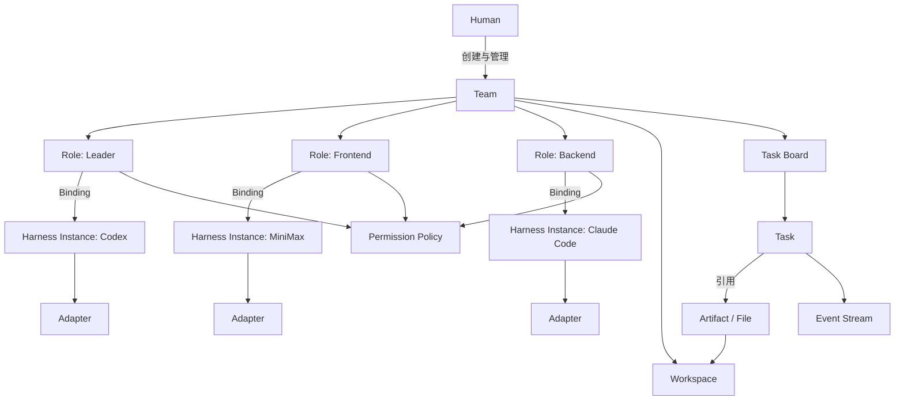
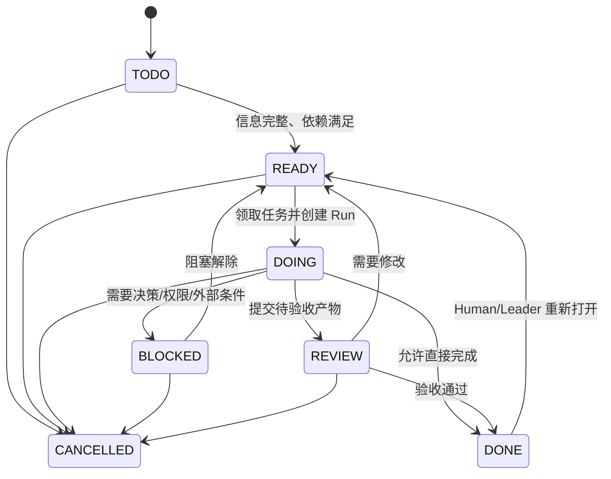

# 多 Harness AI 开发团队协作平台 PRD

> 文档状态：产品方案基线稿  
> 版本：V1.0  
> 日期：2026-09-20  
> 适用读者：产品、设计、架构、客户端/服务端开发、Harness Adapter 开发、测试  
> 暂定产品代号：AI Team Workspace（下文简称“平台”）

---

## 1. 文档目的

本文定义一个面向 AI 软件开发团队的多 Harness 协作平台，使 Codex、MiniMax Code、Claude Code、OpenCode 及未来出现的其他 AI Harness，可以像真实团队成员一样，围绕同一个项目空间、固定岗位和任务流程协同工作。

本文重点说明产品边界、核心对象、业务流程、状态机、权限、异常处理、MVP 范围与验收标准。后续团队可在此基础上继续产出技术架构、数据模型、接口协议、交互原型和开发计划。

本文不是某个具体 Harness 的接入手册，也不把 Codex、MiniMax 或 Claude Code 的私有能力写入平台核心协议。

---

## 2. 背景与问题

当前使用多个 AI 编程工具协作时，Human 通常需要同时打开多个客户端或 CLI，手工复制任务、补充上下文、同步进度和搬运结果。随着 Harness 数量增加，会出现以下问题：

1. 不同 Harness 使用不同的账号、模型、认证方式、配置目录和会话机制，无法在一个原生会话中自由切换。
2. 即使重复启动同一种 CLI，多个进程仍可能共享配置、凭据和缓存，形成隐性干扰。
3. 项目知识沉淀在各自会话里，更换 Harness 后，新执行者无法可靠继承岗位上下文。
4. Human 成为任务、上下文和结果的“人工消息总线”，协作成本随 Harness 数量快速上升。
5. 多个 Harness 并行修改同一项目时，容易发生文件覆盖、分支冲突、重复执行和责任不清。
6. 现有方案往往把“模型、Harness、Agent、岗位”混成同一个概念，导致平台难以替换底层工具。

平台需要解决的不是“让多个模型彼此聊天”，而是建立一个稳定的 AI 团队组织与任务协作层。

---

## 3. 产品定义

### 3.1 一句话定义

一个让不同 AI Harness 以固定团队岗位参与项目、通过共享工作空间继承上下文、通过轻量任务协议接收和回传工作的 AI 开发团队协作平台。

### 3.2 五条架构基线

1. **Human owns Organization：** Human 决定团队结构、岗位、Harness 绑定和最终权限。
2. **Harness owns Intelligence：** Harness 负责理解、推理、编码、测试和生成产物。
3. **Workspace owns Knowledge：** 工作空间是项目事实、任务细节和长期记忆的权威来源。
4. **Task Board owns Work State：** 任务面板只维护轻量、可查询、可流转的工作状态。
5. **Protocol owns Routing：** 通用协议只回答“谁负责什么”和“当前做到哪一步”。

核心原则可进一步概括为：

> Protocol 负责“叫谁去干什么”；Workspace 负责“到底干什么、怎么干，以及项目现在是什么”。

### 3.3 产品价值

- Human 面对的是 Leader、产品、前端、后端、测试等岗位，而不是一组不断变化的模型和 CLI。
- 更换 Harness 时，岗位身份、职责、权限、任务历史和项目知识不丢失。
- 各 Harness 保持原生工作方式，平台无需复刻其推理、工具调用和编码能力。
- 任务状态可视、可追踪、可人工接管，多 Harness 可以安全并行。
- 新 Harness 只需实现 Adapter/Connector，即可加入团队，不影响上层产品逻辑。

---

## 4. 产品目标与成功指标

### 4.1 产品目标

1. 建立稳定的 Team—Role—Harness 三层关系，并明确岗位身份与 Harness 实例分离。
2. 让 Human 可以创建团队、设置岗位、绑定或更换 Harness，并控制岗位权限。
3. 让 Leader 或 Human 能基于共享文件创建、分配和跟踪任务。
4. 让不同 Harness 通过统一 Adapter 接收任务、读取上下文、执行工作、写回产物和更新状态。
5. 支持基本的多任务并发、依赖控制、失败重试、人工接管和审计留痕。
6. 保持平台协议薄、对象少、业务无关，避免演化成另一套 AI 聊天协议或编程 Harness。

### 4.2 建议成功指标

| 指标 | MVP 目标 |
|---|---|
| 首次建立一个三岗位团队所需时间 | 15 分钟以内，不含 Harness 自身安装和登录 |
| 任务分配到在线 Harness 的可见延迟 | 本地环境 P95 小于 10 秒 |
| 任务关键操作审计覆盖率 | 100% |
| Harness 换绑后恢复岗位上下文的成功率 | 100% 可读取该岗位未完任务、关联文件和历史产物 |
| Human 手工复制任务上下文的次数 | 典型端到端流程中为 0 |
| 重启恢复 | 平台重启后不丢失团队、绑定、任务、事件和产物索引 |
| 并发任务隔离 | 两个任务并行执行时不发生静默文件覆盖 |

---

## 5. 非目标

MVP 及产品核心不承担以下职责：

1. 不开发新的大模型、Coding Agent 或通用编程 Harness。
2. 不要求 Codex、MiniMax、Claude Code 等彼此直接聊天。
3. 不把 Harness 的完整对话历史作为项目长期记忆，也不保证跨 Harness 迁移隐藏会话状态。
4. 不在协议层理解 PRD、架构、代码、验收标准等业务语义；这些内容由文件承载。
5. 不做统一模型网关，不要求一个 Harness 会话内可以切换所有模型或认证渠道。
6. 不在 MVP 中实现全自动智能拆解、能力匹配、成本最优调度和无人值守交付。
7. 不替代 Git、代码仓库、CI/CD、IDE 或成熟的文档系统；平台只做必要集成和索引。
8. 不默认自动合并代码、部署生产、操作生产数据或批准高风险外部行为。
9. 不把任务面板扩展成重型项目管理套件。

---

## 6. 核心概念与对象模型

### 6.1 对象关系总览



### 6.2 Human

Human 是拥有真实控制权的人类用户，可以是团队所有者、管理员、产品负责人或普通观察者。

Human 的典型职责：

- 创建团队与工作空间。
- 创建岗位、定义职责和权限。
- 配置 Harness 实例并绑定到岗位。
- 审批高风险动作、处理业务决策、人工接管任务。
- 查看任务、产物、异常、成本和审计记录。

MVP 可先支持单一 Owner；数据模型应保留未来多 Human 成员和不同权限级别。

### 6.3 Team

Team 是协作边界，也是岗位、任务、工作空间、权限和事件的归属容器。

Team 至少包含：

- 基本信息：名称、说明、状态。
- 岗位列表及当前绑定关系。
- 一个逻辑 Workspace。
- 一个 Task Board。
- Permission Policy。
- Event Stream 与通知设置。

不同 Team 默认相互隔离，不能共享任务、文件、Harness 会话或凭据，除非 Human 显式授权。

### 6.4 Role：稳定的岗位身份

Role 是团队内长期存在的组织身份，例如 Leader、产品经理、前端开发、后端开发、QA。

Role 拥有：

- 稳定唯一标识，例如 `role_frontend`。
- 显示名称与岗位说明。
- 职责范围和默认工作目录。
- 任务权限和文件权限。
- 历史任务、历史产物和事件归属。
- 当前 Harness Binding；允许暂时未绑定。

**Role 不等于模型，不等于 Harness，也不等于一次运行会话。**

当 Frontend 从 MiniMax 换成 Claude Code 时，`role_frontend` 不变；其待办任务、权限、历史和文件均保留。

### 6.5 Harness、Harness Type 与 Harness Instance

为避免概念混淆，产品层区分三类信息：

| 概念 | 含义 | 示例 |
|---|---|---|
| Harness Type | 一类执行工具及其能力模型 | Codex、Claude Code、MiniMax Code |
| Harness Instance | 一个已配置、可被平台启动或联系的具体运行实例 | 本机 Codex 登录实例、某容器内 Claude Code 实例 |
| Session / Run | 某个实例为某个任务产生的一次执行 | FE-023 的第 2 次执行 |

Harness Instance 可包含运行位置、版本、能力声明、认证引用、配置隔离目录、在线状态和 Adapter 版本。凭据本身不写入团队文件或事件日志。

### 6.6 Binding：岗位与 Harness 的可变绑定

Binding 连接 Role 与 Harness Instance，并记录生效时间、失效时间、绑定人和版本。

关键规则：

1. Role 可以长期存在而暂时没有 Harness。
2. 一个 Role 在同一时刻默认只有一个“主绑定” Harness。
3. 更换 Harness 只创建新的 Binding 版本，不修改 Role 身份。
4. 旧 Binding 保留审计记录，但失效后不能继续领取新任务。
5. 已运行任务不会因换绑自动交给新 Harness；必须明确选择“完成后换绑”“取消并重启”或“人工接管”。

### 6.7 Adapter / Connector

Adapter 是平台与具体 Harness 之间的翻译层，负责把通用任务事件转换为该 Harness 能理解的启动、恢复、输入和状态回传方式。

Adapter 可以基于 CLI、SDK、API、MCP、ACP、Hooks 或其组合实现，但平台核心不依赖具体方式。

Adapter 的职责：

- 检测 Harness 是否可用并声明能力。
- 创建或恢复执行 Session。
- 注入岗位身份、任务 ID、关联文件和工作目录。
- 采集执行状态、退出原因、日志位置和结果引用。
- 处理取消、超时、心跳和重连。
- 隔离配置目录、环境变量和凭据引用。

Adapter 不负责：

- 理解任务业务内容。
- 替 Leader 拆任务。
- 判断代码是否正确。
- 在 Harness 之间创建私有业务协议。

### 6.8 Workspace：项目事实与长期记忆

Workspace 是团队共享的逻辑项目空间，是项目知识的权威来源。它可以映射为本地目录、Git 仓库、远程仓库、挂载卷或未来的文件服务。

推荐目录约定：

```text
workspace/
├── README.md                 # 工作空间入口和阅读顺序
├── TEAM.md                   # 团队岗位、职责与协作规则
├── PROJECT.md                # 项目目标、范围和当前阶段
├── plans/                    # 方案、拆解和里程碑
├── specs/                    # 产品、接口、设计和验收说明
├── tasks/                    # 任务结果、交接和检查记录
├── questions/                # 阻塞问题与待决策事项
├── decisions/                # 已确认决策
├── artifacts/                # 报告、截图、构建物索引等
├── code/                     # 可选；代码仓库或其入口
└── .team/                    # 平台生成的非业务元数据，可隐藏
```

平台不强制解析这些 Markdown 的业务内容，但应提供文件引用、打开、预览和版本信息。

#### 共享空间与执行空间

为了同时满足“共享知识”和“并行开发”，Workspace 在逻辑上分为：

- **Shared Workspace：** 团队共同读取的计划、规范、决策和已发布产物。
- **Task Execution Workspace：** 某次任务运行的隔离工作区，推荐使用 Git branch/worktree 或容器挂载。

Harness 收到任务时可读取 Shared Workspace，并在自己的 Task Execution Workspace 中修改代码。完成后把结果、提交、Diff、报告或产物链接发布回共享空间与任务记录。这样不会让两个 Harness 静默覆盖同一文件。

非 Git 工作空间在 MVP 中采用单写者限制，不能安全并行写同一路径。

### 6.9 Task：工作状态索引

Task 是轻量结构化工作项，不承载完整需求正文。

MVP 建议字段：

```yaml
id: FE-023
title: 实现 Login UI
team_id: project-nova
owner_role_id: role_frontend
created_by: role_leader
status: READY
priority: normal
references:
  - plans/account-system-plan.md#FE-023
depends_on:
  - BE-018
result_references: []
blocked_reason_reference: null
active_run_id: null
created_at: 2026-09-20T10:00:00+08:00
updated_at: 2026-09-20T10:00:00+08:00
```

任务面板是索引，不重复存储长篇 Description、技术方案、验收细节和讨论记录。详情页应优先展示关联文件内容或打开入口。

### 6.10 Execution Run：一次可重试的执行

Task 表示业务工作，Run 表示 Harness 的一次执行尝试。区分二者可以避免“CLI 崩溃一次就把任务判定失败”。

Run 记录：

- 所属 Task、Role、Binding、Harness Instance。
- 尝试序号与触发方式。
- 运行状态、开始/结束时间、心跳。
- 隔离工作区、Session 引用、日志引用。
- 退出原因、错误分类和结果引用。
- 幂等键和任务租约。

Run 是平台内部执行对象，可以在 MVP UI 中简化为“执行记录”。

### 6.11 Artifact：产物索引

Artifact 是对工作空间文件、Git Commit、Diff、构建物、测试报告、截图或外部链接的结构化引用，而不是另一套内容仓库。

常见类型：

- `document`：任务拆解、设计、结果说明。
- `code_change`：Commit、Branch、Pull Request、Diff。
- `test_report`：测试日志与报告。
- `build`：安装包、可执行文件、预览地址。
- `decision`：已确认决策文件。
- `question`：阻塞问题文件。

每个 Artifact 应记录创建者 Role、产生它的 Run、位置、版本/校验信息和可见范围。

### 6.12 Event 与 Role-to-Role Message / Thread

平台以 Event 作为系统事实、协作留痕和通知源，不把完整 Harness 私有对话作为核心对象。需要另一个岗位理解、处理或回复的协作内容，则以持久化的 Message / Thread 承载；二者可以互相引用，但不可互相替代。

典型 Event：

- `ROLE_BOUND`、`ROLE_UNBOUND`、`ROLE_REBOUND`
- `TASK_CREATED`、`TASK_ASSIGNED`
- `TASK_STATUS_CHANGED`、`TASK_BLOCKED`
- `TASK_REVIEW_REQUESTED`、`TASK_COMPLETED`
- `RUN_STARTED`、`RUN_HEARTBEAT_LOST`、`RUN_FAILED`、`RUN_RETRIED`
- `ARTIFACT_LINKED`
- `PERMISSION_DENIED`
- `HUMAN_TAKEOVER_STARTED`

Event 只保存“谁在什么时候对什么做了什么”和必要引用。需要详细说明时，Event 指向 Workspace 文件。

Message 是短指令、状态提醒、问题、回答、交接或人工备注，不是长期知识库。一个 Message 至少应包含稳定的 `from_role_id`、`to_role_id`、`thread_id`、类型、可选 `task_id`、文件引用、正文、`reply_to`、幂等键及入队时的 Binding 快照；目标必须是稳定 Role，不能直接写入某个 Harness 名称。

消息采用非即时投递状态：

```text
DRAFT → QUEUED → ROUTED → DELIVERED → ACKNOWLEDGED → PROCESSING → REPLIED
          ↖ RETRYING ↙                 ↘ FAILED / EXPIRED / NEEDS_HUMAN
```

- Team Space 在实际投递时解析目标 Role 的当前有效 Binding；换绑只影响后续投递，不改写历史 Thread 和原消息归属。
- 无有效 Binding、目标离线或 Adapter 拒收时，原消息必须持久保留并生成可审计 Event；支持幂等重试，改派仅限 Human 或获授权 Role。
- `RETRYING` 是一次投递尝试中的瞬态状态，而非最终状态：成功后进入 `DELIVERED`，可继续重试时回到 `QUEUED`，达到重试上限则进入 `FAILED`，超过交付 TTL 则进入 `EXPIRED`。两种终态均保留原消息、Binding 快照、失败原因和完整审计链。
- 收到消息不等于自动领取 Task，也不能绕过权限、依赖、租约或 Human 审批。
- 重要回答和决策仍必须写入 Workspace；Message 只保存协作入口、引用和可回放上下文。

### 6.13 Permission Policy

Permission Policy 定义 Human、Role、Harness Instance 对任务、文件和外部能力的可用范围。Harness 的实际权限不得超过所绑定 Role 的权限。

有效权限由以下因素共同决定：

```text
有效权限 = Team 上限
         ∩ Role 权限
         ∩ Task 授权范围
         ∩ Workspace 路径范围
         ∩ Harness 能力
         ∩ Human 审批结果
```

---

## 7. 角色体系与默认权限

### 7.1 Human 角色

| Human 角色 | 核心权限 |
|---|---|
| Owner | 创建/归档团队、管理所有岗位、Harness、凭据引用和权限策略 |
| Admin | 管理岗位、绑定、任务和通知；不能转移所有权 |
| Member | 创建或管理被授权的任务与文件 |
| Viewer | 只读查看任务、事件和允许的文件 |

MVP 只要求 Owner，但应避免把 Owner 权限硬编码进 Task 或 Role。

### 7.2 AI 岗位模板

| 岗位 | 默认任务权限 | 默认文件权限 | 不允许的动作 |
|---|---|---|---|
| Leader | 创建、分配、改状态、设置依赖、发起 Review、验收 | 读写计划、规范、任务和决策；按项目策略写代码 | 修改凭据、给自己扩权、绕过 Human 审批 |
| 产品 | 创建需求任务、补充引用、确认产品决策 | 读写 plans/specs/decisions | 默认不写生产代码、不部署 |
| 前端 | 领取和更新本人任务、提交 Review | 读取共享资料；写前端任务区和被授权代码区 | 分配其他岗位、修改团队设置 |
| 后端 | 同前端 | 读取共享资料；写后端任务区和被授权代码区 | 同前端 |
| QA/Reviewer | 更新 Review 结果、创建缺陷任务 | 读取代码与产物；写测试和评审报告 | 默认不直接改被评审实现 |

Human 可以编辑模板。岗位名只用于展示，权限以 Permission Policy 为准。

### 7.3 Human-only 动作

以下动作默认只能由 Human 执行或批准：

- 绑定、解绑或替换 Harness。
- 修改 Role 权限、Team 安全策略和凭据。
- 删除或归档团队、工作空间和任务记录。
- 访问生产凭据、操作生产数据、付费、发布、部署或对外发送消息。
- 强制取消他人运行、强制接管和绕过依赖。
- 批准超出既定预算或风险等级的动作。

---

## 8. 典型端到端业务流程

### 8.1 建立团队

1. Human 创建 Team，并选择或创建 Workspace。
2. Human 创建 Leader、Frontend、Backend 等 Role。
3. Human 为每个 Role 选择权限模板并调整目录/工具权限。
4. Human 配置 Harness Instance：Codex、MiniMax Code、Claude Code。
5. Human 将 Codex 绑定 Leader，MiniMax 绑定 Frontend，Claude Code 绑定 Backend。
6. 平台验证各 Adapter 可用性，并为每个 Harness 注入岗位入口信息。
7. 团队进入 Active 状态。

### 8.2 Leader 拆解并派工

1. Human 向 Leader 提出“实现账号系统”。
2. Leader 读取 `PROJECT.md`、现有规范和代码。
3. Leader 在 `plans/account-system-plan.md` 写入目标、约束、任务拆解和验收说明。
4. Leader 在 Task Board 创建 FE-023、BE-018 等轻量任务，分别引用该文件中的对应章节。
5. Leader 设置负责人 Role 和依赖关系。
6. 平台产生 `TASK_ASSIGNED` Event，并通过对应 Adapter 通知当前绑定 Harness。

### 8.3 Harness 执行任务

1. Adapter 向 Harness 注入：岗位、任务 ID、标题、关联文件、工作目录和允许动作。
2. Harness 读取 Shared Workspace 和关联文件。
3. Harness 领取任务，平台创建 Run、获取任务租约并把 Task 更新为 `DOING`。
4. Harness 在隔离 Task Workspace 中工作，并按需运行测试。
5. Harness 写入结果说明或其他 Artifact，并把代码 Commit/Diff 与 Task 关联。
6. 需要评审时，Task 进入 `REVIEW`；无需评审且有权限直接完成时进入 `DONE`。

### 8.4 遇到问题并恢复

1. Harness 在 `questions/FE-023-auth-storage.md` 写入问题、已知信息和选项。
2. Harness 将 Task 更新为 `BLOCKED`，并关联问题文件。
3. 平台通知 Leader 和订阅该任务的 Human。
4. Leader 或 Human 在文件中写入决策，并可生成 `decisions/ADR-xxx.md`。
5. Leader 把 Task 恢复为 `READY`。
6. 当前绑定 Harness 重新领取；如期间已换绑，则由新 Harness 读取相同文件后继续。

### 8.5 Review 与返工

1. 实现岗位将 Task 置为 `REVIEW`，关联结果说明、Commit/Diff 和测试报告。
2. Reviewer 读取引用文件与产物，写入评审报告。
3. 通过则 Task 进入 `DONE`。
4. 不通过则 Reviewer 关联修改意见，Task 回到 `READY`；原 Role 或新绑定 Harness 开启新的 Run。
5. 每次执行和评审均保留独立记录，不覆盖历史。

---

## 9. 任务生命周期与状态机

### 9.1 Task 状态

| 状态 | 含义 | 进入条件 |
|---|---|---|
| `TODO` | 已创建，但信息、负责人或前置条件尚未就绪 | 初次创建或主动退回整理 |
| `READY` | 已具备执行条件，可以被负责人领取 | 有负责人、引用有效、依赖已满足 |
| `DOING` | 某个有效 Run 正在执行 | Harness 成功领取并获得租约 |
| `BLOCKED` | 因决策、权限、依赖、环境或外部问题暂停 | 必须有阻塞原因或引用文件 |
| `REVIEW` | 执行产物已提交，等待验收 | 至少有一个结果引用 |
| `DONE` | 已通过约定验收 | Leader、Reviewer 或授权策略确认 |
| `CANCELLED` | 已终止且不再继续 | Human 或有权限的 Leader 取消 |

`ASSIGNED` 不作为状态，而是 Task 的 `owner_role_id` 属性和一次事件；否则“是否有人负责”和“做到哪一步”会混在一起。

`FAILED` 不作为 Task 的终态，而是 Run 状态。一次 Run 失败后，Task 可以重试、换 Harness、转 `BLOCKED` 或由 Human 接管。

### 9.2 Task 状态机



### 9.3 Run 状态

`QUEUED → STARTING → RUNNING → SUCCEEDED / FAILED / TIMED_OUT / CANCELLED`

Run 成功不必然等于 Task 完成。例如代码已生成但仍需 Review 时，Run 为 `SUCCEEDED`，Task 为 `REVIEW`。

### 9.4 状态变更约束

- 所有状态变更必须记录操作者、时间、原状态、新状态和关联 Run/Event。
- 进入 `BLOCKED` 必须填写短原因，推荐关联问题文件。
- 进入 `REVIEW` 必须至少关联一个结果 Artifact。
- 进入 `DONE` 必须满足该任务定义的验收策略。
- Harness 只能更新自身 Role 拥有的 Task，除非 Role 被额外授权。
- 并发更新采用版本号或乐观锁，冲突时不得静默覆盖。

---

## 10. 多 Harness 并发与任务依赖

### 10.1 并发模型

不同 Role 的独立 Task 可以并行运行。平台为每个 Run 创建隔离执行空间，并向 Shared Workspace 发布结果引用。

平台至少需要解决三类冲突：

1. **重复领取：** 同一 Task 同时被两个 Run 执行。
2. **文件覆盖：** 两个 Task 同时修改同一工作目录或文件。
3. **结果过期：** 下游任务基于旧版本输入完成，但上游已变化。

对应策略：

- Task 领取时获得带过期时间的租约和 fencing token；同一 Task 同时只有一个有效主 Run。
- Git 项目默认采用每 Task 独立 branch/worktree；非 Git 目录采用单写者或路径写锁。
- Artifact 记录基线 Commit/版本和校验值；提交 Review 时检测基线是否过期。
- Adapter 心跳丢失后先冻结租约，确认过期后才允许新 Run 接管。
- 不自动吞并冲突；冲突应变成显式 `BLOCKED` 或集成任务。

### 10.2 任务依赖

Task 支持 `depends_on`，形成有向无环依赖图。

规则：

- 所有前置任务为 `DONE` 后，下游任务才能自动从 `TODO` 进入 `READY`。
- 前置任务为 `CANCELLED` 时，下游默认进入 `BLOCKED`，由 Leader 决定改依赖或取消。
- 不允许创建循环依赖；保存时必须校验。
- Human/Leader 可显式允许“软依赖”，即未完成也可执行，但必须记录覆盖原因。
- 上游 `DONE` 后重新打开，平台应提示下游结果可能过期，不自动撤销其成果。

### 10.3 并行拆分建议

平台不自动理解业务拆分，但可以给 Leader 以下结构化能力：

- 设置前置依赖。
- 标记共享资源或预期改动目录。
- 创建集成/联调任务。
- 查看并发冲突提示。
- 按 Role 限制最大并发 Run 数。

MVP 不做复杂资源调度和自动冲突合并。

---

## 11. Harness 替换与上下文继承

### 11.1 基本原则

Harness Session 不是项目记忆；Workspace、Task、Artifact 和 Event 才是。

换绑后继承的是岗位的显式上下文，而不是旧 Harness 的隐藏思考或私有对话。

### 11.2 换绑流程

1. Human 在 Role 详情页选择“更换 Harness”。
2. 平台显示该 Role 的待办任务、正在运行的 Run 和风险提示。
3. Human 选择运行中任务处理方式：
   - **完成后换绑：** 旧 Harness 不再接新任务，当前 Run 可完成。
   - **取消并重启：** 取消旧 Run，保留已产生 Artifact，由新 Harness 开新 Run。
   - **立即人工接管：** 暂停自动执行，Human 处理后再绑定。
4. 平台使旧 Binding 失效，创建新 Binding。
5. Adapter 为新 Harness 生成岗位启动包并执行可用性检查。
6. 新 Harness 读取未完成任务和关联文件后继续工作。

### 11.3 岗位启动包

启动包应由引用组成，不复制整个项目：

- Team、Role 名称及职责。
- Role 权限摘要和禁止行为。
- Workspace 根目录与阅读顺序。
- `README.md`、`TEAM.md`、`PROJECT.md`。
- 该 Role 的 `READY`、`DOING`、`BLOCKED`、`REVIEW` 任务列表。
- 每个任务的引用文件、结果、阻塞项和最近相关 Event。
- 当前代码基线、执行工作区和验证命令入口。

### 11.4 上下文完整性要求

- 任务不可只依赖旧 Session 中的口头说明。
- 重要决策必须写入 `decisions/`、任务引用或其他共享文件。
- 若新 Harness 判断上下文不足，应将 Task 置为 `BLOCKED` 并指出缺失内容，而不是猜测。
- 换绑操作不修改任务 owner；owner 始终是 Role。

---

## 12. 失败、重试与人工接管

### 12.1 错误分类

| 类型 | 示例 | 默认处理 |
|---|---|---|
| 瞬时基础设施错误 | 进程启动失败、短时网络中断 | 在限制内自动重试 Run |
| Harness 不可用 | 未登录、版本不兼容、Adapter 失联 | Task 保持 READY 或转 BLOCKED，通知 Human |
| 权限不足 | 无权写目录、缺少审批 | Task 转 BLOCKED，产生权限事件 |
| 上下文不足 | 引用文件不存在、要求不明确 | Task 转 BLOCKED，创建问题引用 |
| 执行失败 | 编译失败、测试失败、Harness 主动报告无法完成 | 保留产物，通知负责人，由策略决定重试或 Review |
| 超时/心跳丢失 | Run 长时间无心跳 | 标记 TIMED_OUT；租约到期后允许接管 |
| 代码冲突 | 合并冲突、基线过期 | 创建显式集成/冲突任务，不静默覆盖 |
| 风险动作待批 | 部署、付费、生产操作 | 暂停 Run，等待 Human 审批 |

### 12.2 重试策略

- 自动重试只用于已识别的瞬时错误，并设置次数、退避和总时长上限。
- 每次重试创建新 Run，不覆盖旧 Run。
- 使用幂等键防止重复创建任务、重复发布 Artifact 和重复状态变更。
- 重试前确认旧租约失效，避免两个 Harness 同时继续写入。
- 同一错误连续达到阈值后停止自动重试，Task 转 `BLOCKED` 并通知 Human。

### 12.3 人工接管方式

Human 可选择：

1. 暂停自动执行，直接编辑文件或操作代码。
2. 以该 Role 的任务上下文打开终端/IDE，但操作仍记录为 Human。
3. 更换 Harness 后重新执行。
4. 把 Task 重新分配给其他 Role。
5. 修改引用文件、权限或依赖后恢复为 `READY`。
6. 取消任务。

人工接管不能篡改旧 Run 历史；新产生的文件和状态变更必须有 Human 身份留痕。

---

## 13. 权限与隔离设计

### 13.1 隔离层级

- **团队隔离：** Team 之间默认不可互读。
- **身份隔离：** Role 与 Harness Instance 分离；换绑不继承旧实例凭据。
- **配置隔离：** 每个 Harness Instance 使用独立配置目录和运行环境。
- **任务隔离：** 每个 Run 使用独立执行工作区。
- **文件隔离：** Role 仅可访问授权路径和 Artifact。
- **凭据隔离：** 只向特定 Run 注入最小范围凭据，不把明文写入 Workspace。
- **外部动作隔离：** 网络、部署、付费、消息发送和生产操作按策略审批。

### 13.2 权限检查时机

权限必须在以下时机检查：

- 任务创建、分配、重分配和状态更新。
- Run 启动和恢复。
- Workspace 读写或挂载。
- 凭据注入与外部工具调用。
- Artifact 发布与跨 Team 分享。
- 高风险动作审批。

Adapter 报告的“Harness 支持某能力”不代表它有权使用该能力。

### 13.3 安全原则

- 默认最小权限，拒绝优先。
- Harness 不能修改自身 Role 的权限或 Binding。
- 所有拒绝产生可审计 Event，但不记录秘密内容。
- 日志、文件预览和错误信息必须做凭据脱敏。
- 删除、部署、发布、付费、生产数据修改等动作应支持 Human 门禁。
- Team Workspace 中禁止保存长期明文 API Key、Cookie 和登录令牌。

---

## 14. 通用协议边界

### 14.1 协议目标

协议只支持身份绑定、任务路由、状态更新和查询。Workspace 读写优先使用 Harness 原生文件能力和标准文件系统/Git，不额外包装业务文件协议。

### 14.2 MVP 逻辑操作

```text
ROLE / BINDING
- get_role_context(role_id)
- bind_role(role_id, harness_instance_id)       # Human only
- unbind_role(role_id)                          # Human only
- get_binding_status(role_id)

TASK
- create_task(title, owner_role_id, references, depends_on?)
- assign_task(task_id, owner_role_id)
- get_task(task_id)
- list_tasks(filters)
- claim_task(task_id, binding_version, idempotency_key)
- update_task(task_id, expected_version, status?, references?, results?)
- release_task(task_id, run_id)

RUN
- start_run(task_id)
- heartbeat(run_id)
- finish_run(run_id, outcome, result_references?)
- cancel_run(run_id)

EVENT
- list_events(cursor, filters)
- subscribe_events(role_id)
- acknowledge_event(event_id)

MESSAGE / THREAD
- send_message(to_role_id, type, task_id?, references?, body, reply_to?, idempotency_key)
- get_thread(thread_id)
- list_threads(role_id, filters)
- acknowledge_message(message_id)
- reply_message(message_id, type, body, references?, idempotency_key)
- retry_message(message_id)
- reassign_message(message_id, target_role_id)  # Human / 授权 Role only
```

产品 UI 可隐藏 Run 和租约细节，但协议需要这些最低能力来保证并发安全和恢复。

### 14.3 协议设计要求

- Harness 无关，字段中不得出现 Codex/Claude/MiniMax 专属业务语义。
- 每个变更操作支持幂等键。
- 更新支持对象版本号，防止并发覆盖。
- Event 至少一次投递；消费者必须能去重。
- Message 至少一次投递；以 `idempotency_key` 去重，并保留路由、送达、确认、回复和需人工处理的审计 Event。
- 通知订阅可按 Team、Role、事件类型和严重级别配置；去重窗口、重试上限和投递范围必须可查询与调整。
- 已入队消息保留入队时的 Binding 快照；重试或改派只影响后续投递，不能篡改历史 Thread。
- 引用使用稳定的 Workspace 相对路径、Git 引用或受控 URL。
- Adapter 版本和能力可查询。
- 错误码区分认证、权限、冲突、无效状态、依赖未满足、Harness 不可用和系统错误。

---

## 15. 任务面板需求

### 15.1 面板定位

Task Board 是团队工作状态索引，不是详细需求仓库。

### 15.2 列表/看板字段

- Task ID、标题。
- Owner Role；可辅助显示当前绑定 Harness，但 Harness 不是负责人。
- 状态、优先级。
- 依赖与阻塞标记。
- 主要 Reference。
- 最近更新时间与当前 Run 状态。
- 是否待 Human 处理。

### 15.3 Task 详情页

- 基本字段与状态操作。
- Owner Role 与当前 Binding 快照。
- 引用文件列表，可直接打开/预览。
- 依赖、下游任务和基线过期提示。
- Run 历史、失败原因和重试入口。
- Artifact 与结果列表。
- Activity Stream。
- 人工接管、换绑、取消等操作。

### 15.4 必要筛选

- 按 Role、状态、Harness 在线状态、待审批、阻塞原因筛选。
- “与我有关”：Human 待决策、待审批、失败和高风险事项。
- “当前运行”：所有 `DOING` Task 与 Run 健康状态。

---

## 16. 文件空间与 Artifact 体验

### 16.1 文件空间能力

MVP 需要：

- 浏览目录与文件。
- Markdown 预览。
- 从 Task 打开到具体文件或标题锚点。
- 查看文件最后修改人/Role、时间和 Git 状态。
- 将文件或 Git 变更关联为 Artifact。
- 提示并发修改和写入冲突。

### 16.2 文件入口约定

每个 Team 应有明确的 Workspace 入口页，至少说明：

- 项目目标和当前阶段。
- 团队岗位和职责。
- 新 Harness 应先读哪些文件。
- 如何运行、测试和验证。
- 重要目录和禁止修改区域。
- 任务结果应写到哪里。

### 16.3 事实来源优先级

发生冲突时建议采用以下优先级：

1. Human 最新明确决策及其记录。
2. `decisions/` 中已生效决策。
3. 当前任务引用的 spec/plan。
4. `PROJECT.md`、`TEAM.md` 和仓库规范。
5. Task Board 的轻量字段。
6. Event/运行日志。
7. Harness 私有会话内容。

Task Board 与文件不一致时，应提示 Human/Leader 修正，不由平台猜测业务事实。

---

## 17. 通知与事件机制

### 17.1 Activity Stream

Activity Stream 展示系统事实，例如：

```text
10:32 Leader → Frontend：分配 FE-023，参考 plans/account-system-plan.md#FE-023
10:35 Frontend：领取 FE-023，Run #1 启动
11:21 Frontend：FE-023 → BLOCKED，参考 questions/FE-023-auth-storage.md
11:30 Leader：阻塞已解除，FE-023 → READY
12:14 Frontend：提交结果，FE-023 → REVIEW
12:28 Leader：验收通过，FE-023 → DONE
```

### 17.2 通知触发条件

默认通知：

- 新任务分配给 Role。
- Task 进入 `BLOCKED` 或 `REVIEW`。
- Run 失败、超时或 Harness 离线。
- 需要 Human 权限审批或产品决策。
- Harness 换绑完成或失败。
- 依赖满足、任务变为 `READY`。
- 检测到代码/文件冲突或结果过期。

### 17.3 通知原则

- Event 是事实记录，Notification 是面向某个接收者的投递。
- 通知失败不影响 Event 和任务状态，允许重发。
- 同类高频心跳不进入用户通知流。
- Human 可按 Team、Role、严重级别和事件类型订阅。
- Harness 只接收其 Role 有权看到且与工作有关的事件。

---

## 18. 推荐信息架构

### 18.1 全局层级

```text
全局
├── 我的工作台
│   ├── 待我处理
│   ├── 运行中
│   ├── 异常与阻塞
│   └── 最近活动
├── 团队
│   └── Team Detail
├── Harness 连接
└── 全局设置
```

### 18.2 Team 内部导航

```text
Team
├── 概览
│   ├── 团队状态
│   ├── 岗位与在线情况
│   ├── 任务统计
│   └── 待 Human 处理
├── 任务
│   ├── 看板
│   ├── 列表
│   ├── 依赖视图
│   └── 执行记录
├── 工作空间
│   ├── 文件
│   ├── 最近变更
│   └── Artifact
├── 活动
├── 团队成员
│   ├── Human
│   ├── Role
│   └── Binding 历史
└── 设置
    ├── 权限
    ├── Harness/Adapter
    ├── 通知
    └── 安全与审计
```

### 18.3 关键交互原则

- 页面优先展示 Role，Harness 作为 Role 的当前执行者附属显示。
- 所有 Harness 名称旁明确标注“当前绑定”，避免用户把 Harness 当成任务所有者。
- Task 详情将关联文件放在显著位置，减少长文本重复录入。
- 出现异常时同时展示“发生了什么、影响什么、Human 可做什么”。
- 高风险操作提供影响说明和确认，不让 Harness 自行扩大权限。

---

## 19. 关键用户故事

### US-01 创建 AI 团队

作为 Human Owner，我希望创建一个团队并添加 Leader、前端、后端岗位，以便用组织结构管理 AI 执行者。

验收重点：岗位可在没有 Harness 时存在；岗位 ID 稳定。

### US-02 为岗位绑定 Harness

作为 Human Owner，我希望把 Codex 绑定到 Leader，把 MiniMax 绑定到前端，把 Claude Code 绑定到后端，以便各自承担固定职责。

验收重点：绑定前完成可用性检查；权限来自岗位而不是 Harness。

### US-03 基于文件拆解并派发任务

作为 Leader，我希望先写 `task-breakdown.md`，再创建只含标题、负责人、状态和引用的任务，以便避免在任务面板重复维护长篇上下文。

验收重点：任务引用可定位到文件和锚点；接收者能直接读取。

### US-04 多 Harness 并行执行

作为 Leader，我希望前端和后端同时工作，同时不会互相覆盖代码，以便缩短交付时间。

验收重点：各 Run 使用隔离空间；结果带基线和变更引用。

### US-05 管理任务依赖

作为 Leader，我希望前端任务依赖后端接口任务，以便在接口未完成时不自动启动前端联调。

验收重点：依赖满足后自动 Ready；循环依赖被拒绝。

### US-06 Harness 换绑

作为 Human，我希望把前端岗位从 MiniMax 换成 Claude Code，而不丢失该岗位的任务、文件、权限和历史。

验收重点：任务 owner 仍是 Frontend Role；新 Harness 能读取完整显式上下文。

### US-07 失败重试

作为 Human，我希望看到某次执行为什么失败，并选择重试、换 Harness 或人工接管。

验收重点：旧 Run 和产物保留；新 Run 有独立记录；不会双写。

### US-08 阻塞与决策

作为开发岗位 Harness，我希望在上下文不足时写入问题文件并把任务标记为阻塞，以便 Leader 或 Human 做出决策。

验收重点：`BLOCKED` 必须有原因；决策后可以恢复执行。

### US-09 权限隔离

作为 Human Owner，我希望前端 Harness 只能访问授权目录，不能读取生产凭据或修改团队权限。

验收重点：越权被拒绝并留痕；错误与日志不泄露秘密。

### US-10 审计与回放

作为 Human，我希望回看一个任务由哪个岗位、哪个 Harness、哪个 Run 在何时完成，并打开其产物。

验收重点：Role、Binding 快照、Run、Event 和 Artifact 可串联查询。

---

## 20. 功能需求

优先级定义：P0 为 MVP 必须；P1 为首个增强版本；P2 为后续能力。

### 20.1 团队与岗位

| 编号 | 需求 | 优先级 |
|---|---|---|
| FR-001 | 创建、查看、编辑和归档 Team | P0 |
| FR-002 | 创建、编辑、停用 Role；Role ID 保持稳定 | P0 |
| FR-003 | 为 Role 定义职责、默认目录和权限模板 | P0 |
| FR-004 | 查看 Role 的任务、Artifact 和 Binding 历史 | P0 |
| FR-005 | 支持多 Human 成员与邀请 | P1 |

### 20.2 Harness 与 Adapter

| 编号 | 需求 | 优先级 |
|---|---|---|
| FR-010 | 注册 Harness Instance，记录类型、版本、位置和能力 | P0 |
| FR-011 | Adapter 健康检查、能力发现和错误诊断 | P0 |
| FR-012 | 绑定、解绑、换绑 Role，并保留历史 | P0 |
| FR-013 | 独立配置目录、凭据引用和 Session 隔离 | P0 |
| FR-014 | 支持取消、心跳、超时和恢复 | P0 |
| FR-015 | Adapter SDK 与第三方 Harness 接入文档 | P1 |

### 20.3 Workspace 与 Artifact

| 编号 | 需求 | 优先级 |
|---|---|---|
| FR-020 | 为 Team 绑定本地/Git Workspace | P0 |
| FR-021 | 浏览、打开和预览 Markdown 文件 | P0 |
| FR-022 | Task 可引用文件、锚点、Commit、Diff 和报告 | P0 |
| FR-023 | 为并行 Run 创建隔离执行空间 | P0 |
| FR-024 | 记录 Artifact 的创建者、Run、版本和位置 | P0 |
| FR-025 | 文件变更历史、冲突提示和 Artifact 搜索 | P1 |

### 20.4 Task 与 Run

| 编号 | 需求 | 优先级 |
|---|---|---|
| FR-030 | 创建、分配、重分配、取消、重新打开 Task | P0 |
| FR-031 | 支持规定状态机和状态变更校验 | P0 |
| FR-032 | 支持 Task 依赖并拒绝循环依赖 | P0 |
| FR-033 | Task 领取租约、版本检查和幂等更新 | P0 |
| FR-034 | Run 创建、心跳、完成、失败、取消和重试 | P0 |
| FR-035 | Review 通过或退回，关联评审 Artifact | P0 |
| FR-036 | 自动派单和能力匹配 | P2 |

### 20.5 权限、事件和通知

| 编号 | 需求 | 优先级 |
|---|---|---|
| FR-040 | 基于 Team/Role/路径/动作的权限检查 | P0 |
| FR-041 | Human-only 高风险动作和审批门禁 | P0 |
| FR-042 | 不可变关键 Event 与 Activity Stream | P0 |
| FR-043 | 阻塞、失败、Review、审批等应用内通知 | P0 |
| FR-044 | 邮件、Slack、Webhook 等外部通知 | P1 |
| FR-045 | Event 导出和合规审计 | P1 |

### 20.6 Human 控制

| 编号 | 需求 | 优先级 |
|---|---|---|
| FR-050 | 暂停/恢复 Team 或 Role 的自动执行 | P0 |
| FR-051 | 查看失败原因并重试、换绑或人工接管 | P0 |
| FR-052 | 查看并处理待审批动作 | P0 |
| FR-053 | 设置并发数、超时和重试上限 | P1 |
| FR-054 | 成本、Token 和运行资源统计 | P1 |

---

## 21. 非功能需求

### 21.1 可靠性

- Team、Role、Binding、Task、Run、Artifact 索引和 Event 必须持久化。
- 平台异常退出后可恢复未完成任务；无法确认的 Run 标记为未知/待检查，不能直接重复启动。
- Event 投递至少一次，并支持幂等消费。
- 状态更新具备版本控制，禁止最后写入者静默覆盖。

### 21.2 安全性

- 凭据加密存储或引用系统安全存储，不写入 Workspace。
- 日志默认脱敏。
- 最小权限、路径隔离和高风险审批默认开启。
- Adapter 视为不完全可信边界，所有回传都经过身份与权限校验。
- 核心审计记录不可被 Harness 修改。

### 21.3 可扩展性

- 平台核心不依赖特定 Harness、模型、认证方式或操作系统命令。
- Adapter 能力通过版本化契约声明。
- 新增 Harness 不要求修改 Task、Role、Event 等核心对象。
- 本地单机 MVP 的数据结构可迁移到未来的多节点控制面。

### 21.4 可用性

- 产品界面使用岗位语言，技术细节按需展开。
- 异常提示必须说明影响和可选处理方式。
- 新 Harness 入职通过 Workspace 入口文件即可恢复上下文。
- 常见流程不要求 Human 编辑 JSON/YAML 或手工复制 Prompt。

### 21.5 性能

- 本地 MVP 支持至少 1 个 Team、10 个 Role、5 个并发 Run、1 万条 Task/Event 记录时正常使用。
- 常用 Task 列表和详情加载目标 P95 小于 2 秒。
- Adapter 的长任务输出采用流式或增量记录，避免阻塞控制面。

### 21.6 可观察性

- 能查看平台、Adapter、Harness Instance 和 Run 的健康状态。
- 每个 Run 具备结构化开始、心跳、结束和错误信息。
- 支持按 Team、Role、Task、Run 关联查询。
- 监控信息不能成为项目知识的唯一保存位置。

### 21.7 可移植性与可恢复性

- Workspace 和平台元数据可备份与导出。
- Harness 换机或 Adapter 升级不改变 Role 和 Task 标识。
- Artifact 使用相对路径或可迁移引用，避免无必要绑定某台机器的绝对路径。

---

## 22. 异常场景与处理规则

| 场景 | 系统行为 | Human 可选动作 |
|---|---|---|
| Role 未绑定 Harness | Task 可创建和分配，但不启动；提示“待绑定” | 绑定 Harness 或改派 |
| Harness 离线 | 停止派发新任务；运行中任务等待心跳阈值 | 重连、换绑、人工接管 |
| Adapter 版本不兼容 | 禁止新 Run，保留任务和历史 | 升级/降级 Adapter |
| 引用文件不存在 | Task 不能变为 READY，或执行后进入 BLOCKED | 修复引用或补文件 |
| Workspace 无写权限 | Run 失败或 Task BLOCKED，记录权限拒绝 | 调整授权或改用只读任务 |
| 同一 Task 被重复领取 | 后到请求收到冲突；不得产生第二主 Run | 查看当前 Run，必要时强制接管 |
| Task 状态被并发更新 | 版本冲突，要求重新读取 | 重新提交决定 |
| 依赖形成环 | 保存失败并展示环路 | 修改依赖 |
| 上游任务重新打开 | 标记下游“可能过期” | 重验、重跑或确认继续有效 |
| 两个任务修改同一文件 | 在提交/集成时提示冲突 | 建立集成任务或调整拆分 |
| Run 失去心跳后又恢复 | 旧 fencing token 已失效则禁止继续写 | 采用新 Run，保留旧日志 |
| Harness 产生未登记文件 | 扫描提示未关联变更 | 关联 Artifact、忽略或回滚 |
| Harness 请求越权动作 | 拒绝并暂停相关步骤 | 审批临时授权或修改方案 |
| Human 换绑时有运行任务 | 强制选择完成、取消重启或接管 | 按风险处理 |
| 任务 DONE 但验收文件缺失 | 阻止完成或显示不完整 | 补充结果/验收记录 |
| Workspace 与 Task 字段冲突 | 提示不一致，不自动推断 | Leader/Human 修正 |
| 平台重启时 Run 状态未知 | 标记待确认并尝试 Adapter 对账 | 恢复、终止或新建 Run |

---

## 23. MVP 范围

### 23.1 MVP 产品边界

MVP 采用 local-first 单机形态，面向一个 Human Owner 管理一个或少量团队。目标不是建设完整的自治组织，而是验证“岗位稳定、Harness 可换、文件继承、任务派发、并行隔离、状态回传”这一条主链。

### 23.2 MVP 必须包含

1. Team、Role、Binding 基础管理。
2. 至少两个真实 Harness Adapter 跑通；目标演示组合为 Codex + MiniMax Code + Claude Code，第三个可在技术验证后决定是否随首版交付。
3. 一个 Git Workspace，支持 Markdown 浏览与文件引用。
4. Task Board：创建、分配、依赖、状态、Reference、Result。
5. Run：启动、心跳、完成、失败、取消、一次或有限次数重试。
6. Git branch/worktree 级任务隔离；非 Git 目录只支持单写者。
7. 基本 Role 权限、Human-only 换绑与风险操作。
8. Activity Stream、应用内通知和关键审计。
9. Harness 换绑与岗位启动包。
10. Human 可暂停、重试、改派、接管和取消。

### 23.3 MVP 可简化项

- 只有 Human Owner，不做复杂多人协作。
- 权限使用内置模板加少量路径配置，不做图形化策略语言。
- Review 可由 Leader 完成，不要求独立 Reviewer 调度器。
- 只做应用内通知，不接 Slack、邮件等渠道。
- 不做自然语言自动拆解，Leader Harness 自己把拆解写成文件并调用基础任务接口。
- 不做自动合并和部署，完成定义为提交可验收产物。
- 不做 Token 成本优化和模型推荐。

### 23.4 MVP 前置技术验证

在正式开发控制面前，应先完成 Adapter Spike：

- Codex、Claude Code、MiniMax Code 分别如何被外部启动、恢复、取消和注入任务。
- 是否能稳定获得运行状态、退出结果和 Session 引用。
- 如何隔离配置目录、登录态和工作目录。
- 各 Harness 对 MCP、Hooks、CLI、SDK、API 的支持边界。
- 长任务心跳、进程崩溃和平台重启后的恢复方式。

该验证只决定 Adapter 实现，不应反向污染核心对象和任务协议。

---

## 24. 后续版本规划

### V1：团队协作增强

- 多 Human 成员与邀请。
- 独立 Reviewer/QA 流程和可配置验收策略。
- 外部通知、Webhook 和 GitHub/GitLab 集成。
- 远程 Harness、容器和更强沙箱。
- 文件搜索、Artifact 预览、冲突辅助。
- 运行预算、Token、耗时和成本统计。

### V2：自动化与编排

- 基于依赖和并发限制的自动调度。
- 基于 Role 能力与历史表现的 Harness 推荐，但最终换绑权仍归 Human。
- 模板化团队和项目工作流。
- 自动创建 Review、回归测试和集成任务。
- 计划任务、触发器、CI 事件和长周期监控。

### V3：生态与组织级能力

- Adapter Marketplace 和第三方认证。
- 跨 Team Artifact 共享与组织权限。
- 云端控制面与分布式执行节点。
- 质量、成本、交付周期和 Harness 表现分析。
- 在明确规则下的半自动团队扩缩容。

---

## 25. MVP 验收标准

以下场景全部通过，才视为 MVP 主链成立。

### AC-01 团队和岗位稳定性

- Human 可创建 Team、Leader、Frontend、Backend。
- 三个 Role 均有稳定 ID。
- Role 在未绑定 Harness 时仍可存在、被分配任务和查看历史。

### AC-02 Harness 绑定与身份区分

- Codex 可绑定 Leader，另一个 Harness 可绑定 Frontend。
- UI 的任务负责人显示 Role，Harness 仅显示为当前绑定。
- Harness 无法修改自身 Binding 或提升 Role 权限。

### AC-03 文件驱动的派工

- Leader 在 Workspace 创建 `plans/task-breakdown.md`。
- Leader 创建 Task，并引用文件的具体章节。
- 任务面板不要求重复录入完整需求。
- 被绑定 Harness 收到任务后能读取该文件并开始执行。

### AC-04 完整任务流

- Task 能按 `TODO → READY → DOING → REVIEW → DONE` 流转。
- 每次变更均有 Event、操作者和时间。
- 进入 `REVIEW` 时有 Result Artifact；进入 `BLOCKED` 时有原因。

### AC-05 并发与隔离

- Frontend 和 Backend 两个 Task 可并行运行。
- 两个 Run 使用不同的执行工作区。
- 即使修改相同文件，也不会静默覆盖；系统给出冲突或集成提示。

### AC-06 依赖

- 下游 Task 在前置 Task 未完成时不能自动执行。
- 前置完成后，下游可变为 `READY` 并通知负责人。
- 循环依赖创建失败并能定位问题。

### AC-07 失败与重试

- 模拟 Harness 进程异常退出，Run 标记为 `FAILED`，Task 历史和已有 Artifact 不丢失。
- Human 可从 UI 重试，并生成新 Run。
- 旧 Run 失效后不能继续向任务写入有效结果。

### AC-08 Harness 替换与上下文继承

- 将 Frontend 从 Harness A 换为 Harness B 后，Role ID、权限、任务和历史不变。
- Harness B 可读取岗位启动包、未完成任务和关联文件。
- 不需要复制 Harness A 的对话即可继续任务。

### AC-09 权限隔离

- Frontend Harness 访问未授权目录或凭据时被拒绝。
- 拒绝产生审计 Event，且日志中不出现秘密值。
- 高风险动作必须由 Human 批准。

### AC-10 重启恢复

- 平台重启后 Team、Role、Binding、Task、Run、Event、Artifact 索引完整。
- 对重启时正在运行且状态不明的 Run 执行对账，不重复派发。

### AC-11 Human 接管

- Human 可暂停任务、查看当前 Run 和产物，选择改派、换绑、恢复或取消。
- 接管后的操作以 Human 身份记录，不伪装为原 Harness。

### AC-12 可审计闭环

- 从任一 DONE Task 可追溯到：创建者、Owner Role、当时绑定的 Harness、执行 Run、输入 Reference、输出 Artifact、Review 和最终完成事件。

---

## 26. 关键产品决策与待验证问题

### 26.1 已确认的产品决策

1. Role 是团队稳定身份，Harness 是可替换执行者。
2. 任务始终分配给 Role，而不是直接分配给模型或 Harness。
3. Workspace 是项目事实与上下文继承载体。
4. Task Board 只保存轻量结构化索引。
5. Event 负责留痕和通知，不承担业务知识保存。
6. Adapter 解决 Harness 差异，核心协议保持 Harness 无关。
7. Task 失败与 Run 失败分离。
8. 多 Harness 并发必须使用隔离执行空间或单写者约束。
9. Human 拥有换绑、扩权、高风险审批和最终接管权。

### 26.2 需要通过技术验证回答的问题

1. 三个目标 Harness 是否都能稳定支持外部任务注入、取消、恢复和结果识别。
2. 各 Harness 的最佳连接方式是 CLI、SDK、API、MCP/ACP、Hooks 还是混合方案。
3. Session 能否安全复用；不能复用时，启动成本和上下文加载成本是多少。
4. 运行心跳应由 Adapter、进程监视器还是 Harness 原生事件提供。
5. 本地配置和登录态如何做到真正隔离，尤其是同一 Harness 多实例场景。
6. Windows、macOS、Linux 对 worktree、进程和凭据隔离的差异。

这些问题影响 Adapter 和运行时实现，但不改变本文的产品对象和组织模型。

---

## 27. 推荐的后续交付物

完成本 PRD 评审后，建议按以下顺序继续：

1. **关键页面低保真原型：** 团队概览、任务看板、Task 详情、Role/Harness 换绑、异常接管。
2. **领域模型与数据字典：** Team、Role、Binding、Task、Run、Artifact、Event、Permission。
3. **状态与权限规则表：** 明确每个身份可执行的动作和每个状态允许的迁移。
4. **Adapter Spike 报告：** Codex、MiniMax Code、Claude Code 的真实接入能力对比。
5. **通用协议 V0：** 接口、事件、错误码、幂等和版本控制。
6. **本地 MVP 技术架构：** 控制面、持久化、运行时、工作区隔离和安全边界。
7. **端到端验证用例：** 以“账号系统前后端并行开发”为基准演示场景。

---

## 28. 最终产品判断

这个产品的核心竞争力不是比 Codex、Claude Code 或 MiniMax 更会写代码，而是让这些快速变化的 Harness 可以进入同一个稳定组织，并且随时可替换、可追踪、可并行、可接管。

只要以下关系始终不被破坏，平台就能长期保持开放：

```text
岗位属于 Team
任务属于 Role
知识属于 Workspace
执行属于 Run
智能属于 Harness
适配属于 Adapter
控制权属于 Human
```

这也是后续系统设计、接口设计和交互设计的最高优先级约束。
